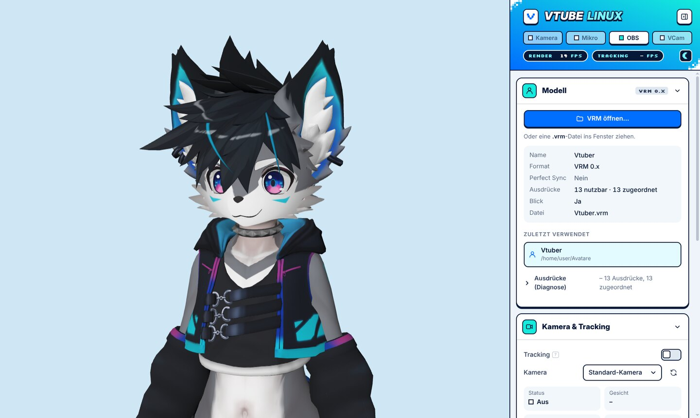
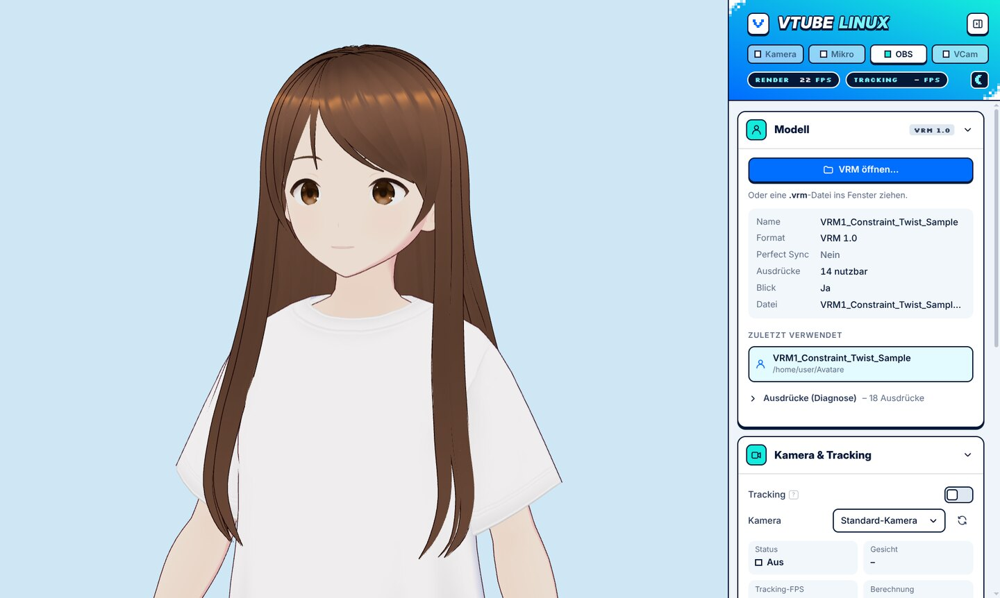
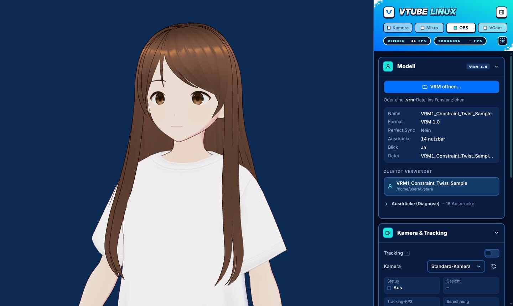

<p align="center"></p>

<h1 align="center">VTube Linux</h1>

<p align="center">
  VTuber-App für Linux: VRM-Avatar (VRM 0.x und 1.0) per Drag &amp; Drop laden, mit einer normalen Webcam steuern.<br>
  <sub><i>VTuber app for Linux: load a VRM avatar, drive it with any webcam. User interface in German.</i></sub>
</p>

<p align="center">
  <a href="https://github.com/MaxiUwe27/VTUBE/releases/latest"></a>
  <a href="https://github.com/MaxiUwe27/VTUBE/actions/workflows/build.yml"></a>
  <a href="LICENSE"></a>
</p>

<p align="center">
  
</p>

## Funktionen

- **Face-Tracking** mit jeder Webcam (MediaPipe, 52 ARKit-Blendshapes, Iris-Blick): Kopf, Hals und Oberkörper
  folgen dem Kopf; Blinzeln inkl. Zwinkern; Blickrichtung; Mund (A/I/U/E/O). Passt sich nach wenigen Sekunden an Ihr Gesicht an.
- **Automatische Emotionen**: Fröhlich, Wütend, Traurig, Entspannt, Überrascht – aus Ihrer echten Mimik, einzeln regelbar.
- **Perfect Sync**: Hat das Modell ARKit-Blendshapes, werden diese direkt angesteuert.
- **Lip-Sync per Mikrofon** zusätzlich zum Kamera-Mund (Mischung einstellbar).
- **Ausgabe**: OBS-Browserquelle (transparent), Chroma-Key-Hintergrund für Fenstererfassung, virtuelle Kamera (v4l2loopback) für Discord, Zoom & Co.
- **Handy als Kamera** (IP Webcam, DroidCam, VDO.Ninja) über eine Browserquellen-URL.
- Robuster Umgang mit konvertierten Avataren (z. B. aus VRChat): fehlende VRM-Ausdrücke werden automatisch zugeordnet, mit Diagnose und Test-Reglern.
- SpringBones (Haare/Kleidung), Atmung/Idle-Animation, Auto-Framing, Kamera-Orbit mit der Maus, helles und dunkles Design.
- Alles läuft lokal – keine Konten, keine Cloud, nichts wird ins Internet geschickt.

<p align="center">
  
  
  <br><sub>Helles und dunkles Design (Umschalten oben rechts im Panel)</sub>
</p>

## Installation

1. Unter **[Releases](https://github.com/MaxiUwe27/VTUBE/releases/latest)** die Datei `VTube-Linux-<version>-x86_64.AppImage` herunterladen.
2. Ausführbar machen und starten:
   ```bash
   chmod +x VTube-Linux-*-x86_64.AppImage
   ./VTube-Linux-*-x86_64.AppImage
   ```

Voraussetzungen: 64-Bit-Linux (x86_64), Webcam, Grafikkarte mit WebGL 2 (jede aktuelle NVIDIA/AMD/Intel).
Läuft auf Fedora/Nobara, Arch, openSUSE, Debian, Ubuntu usw. – nicht an einen bestimmten Avatar oder Rechner gebunden.

- **Ubuntu:** `libfuse2` (22.04) bzw. `libfuse2t64` (ab 24.04) installieren oder mit `--appimage-extract-and-run` starten.
  Ab 24.04 sperrt AppArmor die Chromium-Sandbox → mit `--no-sandbox` starten.
- **Selbst bauen:** `npm ci && npm run dist` → `release/VTube-Linux-<version>-x86_64.AppImage` (Details: [docs/BUILD.md](docs/BUILD.md)).
- **Kurzanleitung zum Weitergeben:** [docs/KURZANLEITUNG.md](docs/KURZANLEITUNG.md).

## Erste Schritte

1. App starten, Kamerazugriff wird automatisch erteilt.
2. `.vrm` ins Fenster ziehen (oder „VRM öffnen…“ / `Strg+O`). Das zuletzt genutzte Modell wird beim Start wieder geladen.
3. Gerade in die Kamera schauen, neutrales Gesicht → **Kalibrieren** (`C`). Das ist wichtig: ohne Kalibrierung ist z. B. eine Kamera über dem Monitor als „Kopf gesenkt“ sichtbar.
4. Feintuning im Seitenpanel (`Tab`/`F1` blendet es aus): Glättung, Stärken, Emotionen. Doppelklick auf einen Regler setzt ihn zurück.
5. Kamera einstellen – direkt mit der Maus im Avatar-Fenster: **linke Taste ziehen** dreht die Kamera um den Avatar
   (z. B. leichte Seitenansicht), **rechte/mittlere Taste ziehen** verschiebt, **Mausrad** zoomt, **Doppelklick** setzt
   die Ansicht zurück. Alternativ unter „Ansicht“: Kugel ziehen, Voreinstellungen oder unter „Mehr Einstellungen“ die Regler „Drehung/Neigung“
   (Frontal, Leicht links/rechts, Profil links/rechts, Von oben – „links/rechts“ = Kamera vom Zuschauer aus gesehen).
   Die Ansicht gilt genauso für OBS-Browserquelle und virtuelle Kamera.

## Handy oder Browserquelle als Kamera

Statt einer Webcam kann das Tracking auch ein Bild aus dem Netz verwenden: In „Kamera & Tracking“
bei **Kamera** ganz unten **„Browserquelle (URL) …“** wählen, die Adresse einfügen, **Verbinden**.
Die Seite wird unsichtbar (wie eine OBS-Browserquelle) geladen; „Auflösung“ und „Kamera-FPS“ (unter „Mehr Einstellungen“) legen
Größe und Bildrate dieser Seite fest. Funktionierende Adressen werden als Vorschläge gemerkt.

| Quelle | Adresse |
|---|---|
| Android-App **IP Webcam** | `http://<Handy-IP>:8080/video` (IP steht in der App unten nach „Server starten“) |
| **DroidCam** (Android/iOS) | `http://<Handy-IP>:4747/video` |
| **VDO.Ninja** (Handy-Browser, auch iPhone) | Am Handy auf vdo.ninja „Add your camera“, den **View-Link** `https://vdo.ninja/?view=…` einfügen |
| Video-Datei / Stream | direkte `http(s)://…`-Adresse einer MP4/WebM-Datei oder eines MJPEG-Streams |

Tipps: Handy und PC im **selben WLAN**; das Handy am besten hochkant in einer Halterung, Gesicht
gut ausgeleuchtet; Displaysperre des Handys aus. Bricht der Stream kurz ab, verbindet sich die App
von selbst neu; kommen 15 s lang keine Bilder, zeigt sie einen Fehler mit „Erneut versuchen“.
**Nicht möglich:** RTSP/RTMP (`rtsp://…`, Chromium kann das nicht – in der App die HTTP-Adresse
nehmen) und HTTPS mit selbst signiertem Zertifikat (z. B. `https://` von IP Webcam – stattdessen
`http://` verwenden). Die Seite läuft abgeschottet: ohne Kamera-/Mikrofonrechte, ohne Pop-ups und
Downloads, stumm.

## OBS

- **Browserquelle (empfohlen):** URL `http://127.0.0.1:39540/`, 1920×1080. Der Hintergrund ist dort standardmäßig
  transparent (unabhängig vom Grün im App-Fenster). Farbe erzwingen: `?bg=00ff00`, App-Einstellung übernehmen: `?bg=app`.
- **Fenstererfassung + Chroma-Key:** Hintergrund Grün (Standard), Panel mit `Tab` ausblenden.
- **Virtuelle Kamera** (für Discord etc.): siehe nächster Abschnitt.

## Virtuelle Kamera (v4l2loopback)

**Jedes Programm mit eigener virtueller Kamera braucht ein eigenes Gerät.** Ein v4l2loopback-Gerät
trägt genau einen Bildstrom, und sein Name (`card_label`) gehört zum Gerät, nicht zum Programm.
Die virtuelle Kamera von OBS fragt nicht nach – sie nimmt das erste freie v4l2loopback-Gerät.
Gibt es nur eines, schreiben OBS und VTube Linux in dasselbe Gerät: Bild kaputt, falscher Name,
oder eines der Programme startet nicht. VTube Linux selbst wählt **nie** automatisch ein Gerät,
sondern schreibt nur in das eingestellte (Standard `/dev/video10`).

Darum zwei Geräte anlegen; OBS bekommt die kleinere Nummer, damit es sein eigenes zuerst findet:
```bash
sudo dnf install v4l2loopback ffmpeg
sudo modprobe -r v4l2loopback   # nur nötig, falls schon geladen (z. B. von OBS); vorher OBS/Discord/Browser schließen
sudo modprobe v4l2loopback devices=2 video_nr=9,10 card_label="OBS Virtual Camera,VTube Linux" exclusive_caps=1,1
```
Dauerhaft (beim Systemstart mit diesen Optionen laden):
```bash
echo v4l2loopback | sudo tee /etc/modules-load.d/v4l2loopback.conf
echo 'options v4l2loopback devices=2 video_nr=9,10 card_label="OBS Virtual Camera,VTube Linux" exclusive_caps=1,1' | sudo tee /etc/modprobe.d/v4l2loopback.conf
```
Ergebnis: `/dev/video9` „OBS Virtual Camera“ (für OBS), `/dev/video10` „VTube Linux“ (für diese App).
In Discord/OBS-Quelle/Zoom dann die Kamera „VTube Linux“ wählen.

**Gerät festlegen** (Vorrang von oben nach unten):

| Weg | Beispiel |
|---|---|
| Startoption | `./VTube-Linux-*.AppImage --vcam-device /dev/video10` (oder `--vcam-device=/dev/video10`) |
| Umgebungsvariable | `VTUBE_CAM_DEVICE=/dev/video10 ./VTube-Linux-*.AppImage` |
| App | „Ausgabe → Virtuelle Kamera → Mehr Einstellungen → Gerät“ (Auswahl zeigt Name, Pfad und ob belegt) |
| Standard | `/dev/video10` |

Ist das Gerät per Startoption/Umgebungsvariable festgelegt, zeigt die App es als „festgelegt“ an und
die Einstellung ist gesperrt. Vor dem Start prüft die App: Gerät vorhanden, wirklich v4l2loopback,
Schreibrechte. Dass andere Programme das Gerät geöffnet haben (z. B. OBS-Quelle oder Discord als
Zuschauer), ist normal und verhindert den Start nicht – die App zeigt sie nur an („Geöffnet von: obs
(PID …)“). Schreibt dort schon ein anderes Programm hinein (oder hält ein Zuschauer noch eine andere
Auflösung fest), lehnt der Kernel ffmpeg ab; die App meldet dann den Grund und welche Programme
(Name + PID) das Gerät geöffnet haben.

**Geräte anzeigen:** `./VTube-Linux-*.AppImage --list-devices` (Alias `--vcam-list`) listet alle
v4l2loopback-Geräte mit Pfad, Name und benutzenden Prozessen und beendet sich sofort (kein Fenster).

## Probleme

| Symptom | Lösung |
|---|---|
| OBS-Browserquelle / Browser-Test leer oder weiß | Die Seite zeigt oben links den Grund (keine Verbindung, kein Modell, WebGL fehlt …). „WebGL nicht verfügbar“ in OBS: *Einstellungen → Erweitert → Browserquellen-Hardwarebeschleunigung* an, OBS neu starten. Diagnose: URL mit `?debug`, `http://127.0.0.1:39540/status`, AppImage im Terminal starten (zeigt Verbindungen/Ablehnungen). `?nostatus` blendet die Hinweise aus |
| Schwarzes Fenster / Absturz beim Start (GPU) | `./VTube-Linux…AppImage --disable-gpu` oder `--ozone-platform=x11` |
| Browserquelle: „Verbindung abgelehnt“ / „Keine Antwort“ | Läuft die Kamera-App auf dem Handy (Server gestartet, Bildschirm an)? Gleiches WLAN? IP und Port prüfen – die Adresse zuerst im normalen Browser am PC testen |
| Tracking langsam | In „Kamera & Tracking → Mehr Einstellungen“ „GPU nutzen“ an/aus testen; 640×480 reicht völlig |
| Avatar schaut schräg | Neu kalibrieren; „Spiegeln“ prüfen |
| Mund bewegt sich beim Reden zu wenig | Lip-Sync aktivieren, Mund-Empfindlichkeit erhöhen |
| Virtuelle Kamera heißt „OBS Virtual Camera“ / Bild von OBS kaputt | Nur ein v4l2loopback-Gerät vorhanden → zwei anlegen (siehe oben), `--list-devices` prüfen |
| AppImage startet nicht (FUSE) | `sudo dnf install fuse fuse-libs` oder `--appimage-extract-and-run` |

Einstellungen: `~/.config/VTube Linux/settings.json`.

## Technik & Mitmachen

Electron 38, three.js + [@pixiv/three-vrm](https://github.com/pixiv/three-vrm), [MediaPipe Tasks Vision](https://github.com/google-ai-edge/mediapipe).

| Dokument | Inhalt |
|---|---|
| [docs/ARCHITECTURE.md](docs/ARCHITECTURE.md) | Aufbau, Module, Datenfluss |
| [docs/BUILD.md](docs/BUILD.md) | Bauen, Start-Optionen, Packaging |
| [docs/AVATAR_ANLEITUNG.md](docs/AVATAR_ANLEITUNG.md) | Anforderungen an eigene Avatare (Unity/UniVRM) |
| [docs/TODO.md](docs/TODO.md) | Geplante Funktionen und bekannte Einschränkungen |

Fehler oder Wünsche bitte als [Issue](https://github.com/MaxiUwe27/VTUBE/issues) melden – am besten mit Distribution,
Grafikkarte und der Ausgabe beim Start im Terminal.

## Lizenz

[MIT](LICENSE). Mitgelieferte Drittanbieter-Komponenten (MediaPipe-Modell: Apache-2.0, Schriften Inter und Silkscreen:
SIL OFL 1.1 u. a.): [THIRD_PARTY_NOTICES.txt](THIRD_PARTY_NOTICES.txt).
Avatare auf den Screenshots: oben der Avatar von MaxiUwe27 (nicht Teil des Projekts, Nutzung und Weitergabe nicht erlaubt);
hell/dunkel „VRM1_Constraint_Twist_Sample“ © 2022 pixiv Inc. (VRM-Lizenz, Nutzung durch alle erlaubt).
